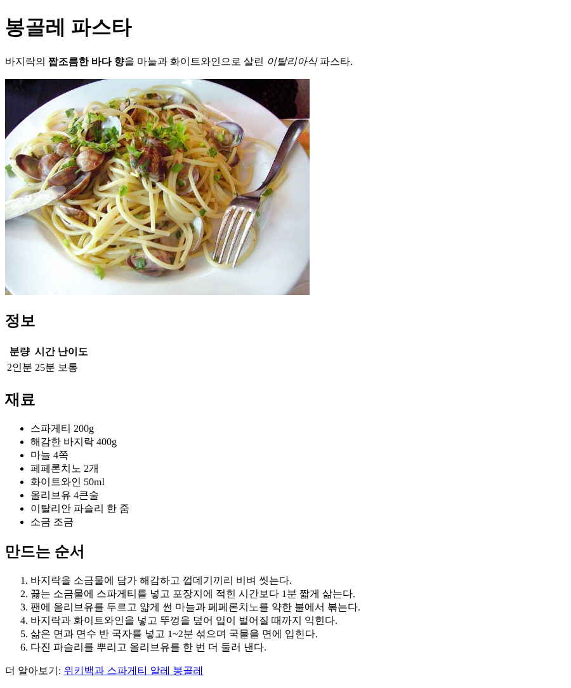

# P1. HTML 로 레시피 쓰기 — `p1: recipe html`

요리 하나의 레시피 페이지를 HTML 로 씁니다. 아직 CSS 는 쓰지 않습니다. 브라우저의 기본 모양으로만 보이는 것이 정상입니다.

**요리는 각자 고릅니다.** 좋아하는 요리, 자주 해 먹는 요리 무엇이든 됩니다. 고르기 어려우면 맨 아래 **기본 레시피(봉골레 파스타)** 의 문구를 그대로 써도 됩니다.

끝나면 페이지에 이것들이 들어 있습니다.

| 내용 | 태그 |
|---|---|
| 요리 이름 | `h1` |
| 한 줄 소개 (강조 두 군데) | `p`, `strong`, `em` |
| 그림 | `img` |
| 정보 (분량·시간·난이도) | `table`, `tr`, `th`, `td` |
| 재료 | `ul`, `li` |
| 만드는 순서 | `ol`, `li` |
| 소제목 (정보, 재료, 만드는 순서) | `h2` |
| 출처나 더 알아보기 링크 | `a` |

모든 내용은 `index.html` 의 `<body>` 안, `<!-- P1: 여기에 레시피를 씁니다 -->` 줄 자리에 씁니다. 그 주석 줄은 지워도 됩니다.
한 단계를 쓸 때마다 저장(`Ctrl+S`)하고 브라우저에서 F5 를 눌러 확인하면서 갑니다.

## 제목, 소개, 그림 (VS Code)

1. 요리 이름을 `h1` 로 씁니다. 한 페이지에 `h1` 은 하나만 둡니다.
   ```html
   <h1>봉골레 파스타</h1>
   ```
2. 그 아래 한 줄 소개를 `p` 로 씁니다. 소개 안에서 중요한 말 하나는 `strong` 으로, 느낌을 살리고 싶은 말 하나는 `em` 으로 감쌉니다.
   ```html
   <p>바지락의 <strong>짭조름한 바다 향</strong>을 마늘과 화이트와인으로 살린 <em>이탈리아식</em> 파스타.</p>
   ```
   브라우저에서 `strong` 부분은 굵게, `em` 부분은 기울어져 보입니다.
3. 그림을 넣습니다. 템플릿에 들어 있는 `images/vongole.jpg` 를 쓰거나, 다른 그림을 `images/` 폴더에 넣고 그 파일 이름을 씁니다.
   ```html
   
   ```
   - `src` 는 `index.html` 에서 본 그림의 위치입니다. 폴더 이름과 파일 이름을 대소문자까지 똑같이 씁니다.
   - `alt` 는 그림이 안 보일 때(경로가 틀렸거나 화면 낭독기로 읽을 때) 대신 나오는 설명입니다. 그림의 내용을 한 문장으로 씁니다.
   - `img` 는 닫는 태그가 없습니다.

## 정보 표 (VS Code)

4. 소제목 `h2` 를 쓰고, 그 아래에 표를 만듭니다. 첫 줄은 머리글(`th`), 둘째 줄은 값(`td`)입니다.
   ```html
   <h2>정보</h2>
   <table>
     <tr><th>분량</th><th>시간</th><th>난이도</th></tr>
     <tr><td>2인분</td><td>25분</td><td>보통</td></tr>
   </table>
   ```
   CSS 가 없어서 지금은 표에 선이 없습니다. 칸이 세 개씩 두 줄로 줄 맞춰 보이면 됩니다. 선은 P2 에서 넣습니다.

## 재료와 순서 (VS Code)

5. `h2` 로 "재료" 를 쓰고, 재료를 `ul` 목록으로 4개 이상 씁니다. 순서가 없는 목록이라 앞에 점(•)이 붙습니다.
   ```html
   <h2>재료</h2>
   <ul>
     <li>스파게티 200g</li>
     <li>해감한 바지락 400g</li>
     ...
   </ul>
   ```
6. `h2` 로 "만드는 순서" 를 쓰고, 순서를 `ol` 목록으로 4개 이상 씁니다. 순서가 있는 목록이라 앞에 1. 2. 3. 이 저절로 붙습니다. 번호를 직접 쓰지 않습니다.

## 링크 (VS Code)

7. 맨 아래에 레시피 출처나 그 요리를 더 알아볼 수 있는 페이지를 링크로 겁니다.
   ```html
   <p>더 알아보기: <a href="https://ko.wikipedia.org/wiki/스파게티_알레_봉골레">위키백과 스파게티 알레 봉골레</a></p>
   ```
   `href` 에는 `https://` 부터 전체 주소를 씁니다. `www.` 로 시작하게 쓰면 브라우저가 "내 폴더 안의 `www.…` 라는 파일" 로 알아듣고 링크가 깨집니다.

## 확인하고 커밋 (브라우저 → 터미널)

8. 브라우저에서 F5. 아래처럼 보이면 됩니다. 큰 제목, 굵은 글씨와 기울어진 글씨, 그림, 줄 맞춘 표, 점 목록, 번호 목록, 파란 밑줄 링크.

   

   링크를 눌러 페이지가 열리는지도 확인합니다(뒤로 가기로 돌아옵니다).
9. **F12** 를 눌러 개발자 도구(DevTools)를 열고 **Elements** 탭을 봅니다. `<body>` 앞의 ▶ 를 누르면 그 안에 `h1`, `p`, `img`, `h2`, `table`, `ul`, `ol` 이 차례로 보입니다. 내가 쓴 HTML 이 트리로 보이는 것입니다. 줄 위에 마우스를 올리면 화면의 그 부분에 파란 상자가 칠해집니다.
10. 커밋하고 push 합니다.
    ```
    git add index.html images
    git commit -m "p1: recipe html"
    git push
    ```
    `images/` 에 그림을 새로 넣지 않았다면 `images` 는 바뀐 게 없어서 그냥 넘어갑니다.

---

## 기본 레시피: 봉골레 파스타

요리를 고르기 어려우면 이 문구를 씁니다.

- 요리 이름: 봉골레 파스타
- 한 줄 소개: 바지락의 **짭조름한 바다 향**을 마늘과 화이트와인으로 살린 *이탈리아식* 파스타.
- 정보: 분량 2인분 / 시간 25분 / 난이도 보통
- 재료: 스파게티 200g · 해감한 바지락 400g · 마늘 4쪽 · 페페론치노 2개 · 화이트와인 50ml · 올리브유 4큰술 · 이탈리안 파슬리 한 줌 · 소금 조금
- 만드는 순서
  1. 바지락을 소금물에 담가 해감하고 껍데기끼리 비벼 씻는다.
  2. 끓는 소금물에 스파게티를 넣고 포장지에 적힌 시간보다 1분 짧게 삶는다.
  3. 팬에 올리브유를 두르고 얇게 썬 마늘과 페페론치노를 약한 불에서 볶는다.
  4. 바지락과 화이트와인을 넣고 뚜껑을 덮어 입이 벌어질 때까지 익힌다.
  5. 삶은 면과 면수 반 국자를 넣고 1~2분 섞으며 국물을 면에 입힌다.
  6. 다진 파슬리를 뿌리고 올리브유를 한 번 더 둘러 낸다.
- 더 알아보기: 위키백과 스파게티 알레 봉골레 `https://ko.wikipedia.org/wiki/스파게티_알레_봉골레`

---

[← 문제 목록](../README.md#문제) · [이전: P0](P0_setup.md) · [다음: P2](P2_selectors.md) · [부록: 흔한 오류](../README.md#부록-흔한-오류)
