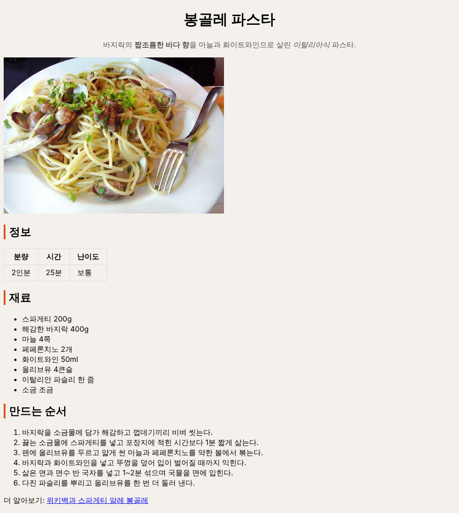

# P2. CSS 연결하고 선택자 세 가지 쓰기 — `p2: selectors`

P1 의 페이지는 브라우저 기본 모양입니다. 이번에는 `style.css` 를 연결하고, 선택자(selector) 세 종류로 꾸밉니다.

| 선택자 | 고르는 것 | 쓰는 곳 |
|---|---|---|
| 태그 이름 `p` | 그 태그 전부 | `body`, `h2`, `th`, `td` |
| 클래스 `.이름` | `class="이름"` 이 붙은 것 전부 | 한 줄 소개 `.summary` |
| 아이디 `#이름` | `id="이름"` 이 붙은 하나 | 요리 이름 `#title` |

## CSS 파일 연결 (VS Code)

1. `index.html` 의 `<head>` 에서 `<!-- P2: 여기에 style.css 를 연결합니다 -->` 줄을 지우고 그 자리에 씁니다.
   ```html
   <link rel="stylesheet" href="style.css">
   ```
   "같은 폴더의 `style.css` 를 이 페이지의 스타일로 쓴다" 는 뜻입니다.

## 태그 선택자 (VS Code → 브라우저)

2. `style.css` 의 첫 줄 주석 아래에 씁니다. 저장하고 브라우저에서 F5.
   ```css
   body {
     background: #f4f1ec;
     font-family: "Segoe UI", "Malgun Gothic", sans-serif;
   }
   ```
   배경이 옅은 베이지색으로, 글꼴이 바뀌면 연결이 된 것입니다. `font-family` 는 앞의 글꼴이 없으면 다음 것을 씁니다. 마지막 `sans-serif` 는 "어느 컴퓨터에나 있는 고딕 계열" 이라는 뜻이라 맨 뒤에 둡니다.

   **아무 변화가 없으면**: F12 → **Console** 탭에 빨간 `style.css ... 404 (File not found)` 가 있는지 봅니다. 있으면 1번의 `href` 와 실제 파일 이름이 다른 것입니다.
3. 소제목 `h2` 왼쪽에 굵은 선을 긋습니다.
   ```css
   h2 {
     border-left: 4px solid #d9541e;
     padding-left: 8px;
   }
   ```
   `h2` 세 개(정보, 재료, 만드는 순서)에 모두 선이 생깁니다. 태그 선택자는 그 태그 전부를 고르기 때문입니다.
4. 표에 선을 넣습니다.
   ```css
   table {
     border-collapse: collapse;
   }

   th {
     border: 1px solid #dddddd;
     padding: 6px 16px;
   }

   td {
     border: 1px solid #dddddd;
     padding: 6px 16px;
   }
   ```
   `border-collapse: collapse` 는 칸마다 따로 그려지는 두 겹의 선을 한 줄로 합칩니다. 지워 보고 F5 로 차이를 본 뒤 다시 넣습니다.

## 클래스 선택자 (VS Code → 브라우저)

5. `index.html` 에서 한 줄 소개 `p` 에 `class` 를 붙입니다.
   ```html
   <p class="summary">바지락의 ...</p>
   ```
6. `style.css` 에 씁니다.
   ```css
   .summary {
     color: #555555;
     text-align: center;
   }
   ```
   한 줄 소개만 회색으로 가운데에 놓이고, 다른 `p`(맨 아래 링크 줄)는 그대로입니다. 점(`.`)으로 시작하면 class 가 붙은 것만 고릅니다.

## 아이디 선택자 (VS Code → 브라우저)

7. `index.html` 에서 `h1` 에 `id` 를 붙입니다.
   ```html
   <h1 id="title">봉골레 파스타</h1>
   ```
8. `style.css` 에 씁니다.
   ```css
   #title {
     text-align: center;
   }
   ```
   요리 이름이 가운데로 갑니다. `#` 으로 시작하면 그 id 를 가진 요소 하나만 고릅니다. id 는 한 페이지에서 한 번만 씁니다.

## 확인하고 커밋 (브라우저 → 터미널)

9. **확인**: 아래처럼 보이면 됩니다. 베이지 배경, 소제목 왼쪽의 주황 선, 선이 있는 표, 가운데의 요리 이름과 회색 한 줄 소개. 내용은 아직 화면 왼쪽 끝부터 퍼져 있습니다(P3 에서 상자에 담습니다).

   
10. F12 → **Elements** 에서 한 줄 소개 `<p class="summary">` 줄을 누릅니다. 오른쪽 **Styles** 에 `.summary { … }` 규칙과 그 옆에 `style.css:…` 가 보입니다. "이 요소에는 style.css 몇째 줄의 이 규칙이 적용되고 있다" 는 뜻입니다.
11. 커밋하고 push 합니다.
    ```
    git add index.html style.css
    git commit -m "p2: selectors"
    git push
    ```

---

[← 문제 목록](../README.md#문제) · [이전: P1](P1_html.md) · [다음: P3](P3_box.md) · [부록: 흔한 오류](../README.md#부록-흔한-오류)
