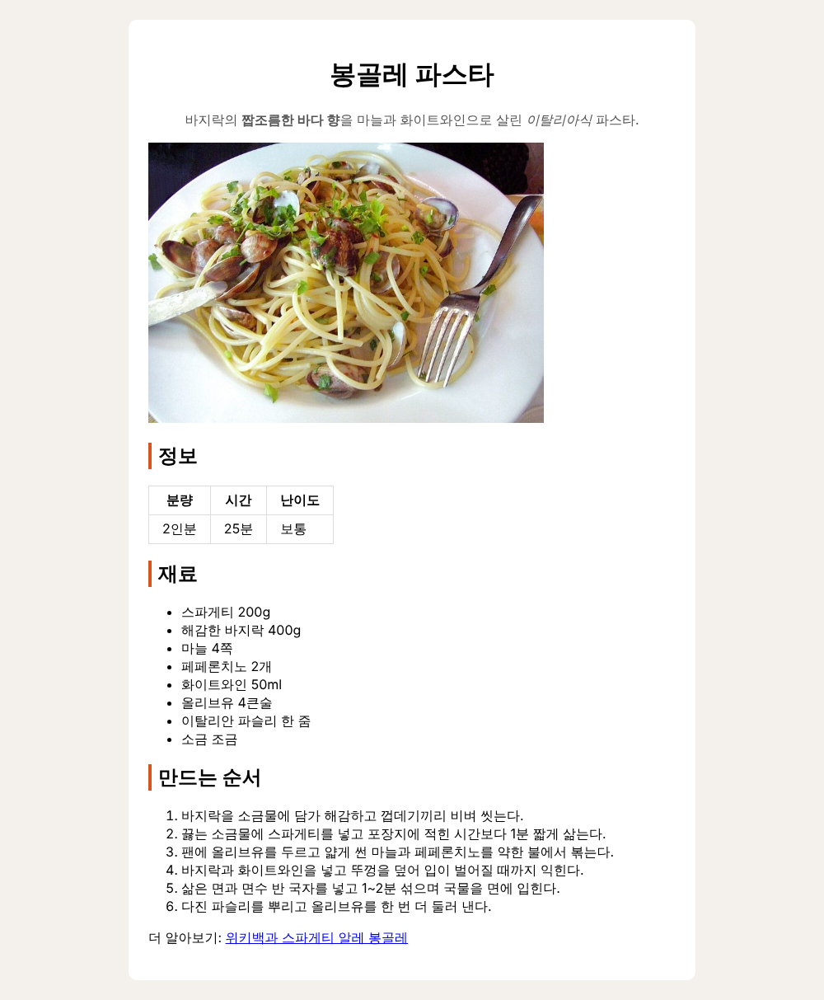

# P3. 박스 모델과 가운데 정렬, DevTools — `p3: box model`

지금은 내용이 화면 왼쪽 끝부터 오른쪽 끝까지 퍼져 있습니다. 내용 전체를 하얀 상자 하나에 담아 가운데에 두고, 상자 안팎의 여백을 정합니다. 그리고 DevTools 에서 값을 바꿔 보며 고른 값을 코드에 옮깁니다.

- `margin` = 상자 **바깥** 여백, `padding` = 상자 **안쪽** 여백 (테두리 `border` 를 기준으로)

## 상자로 감싸기 (VS Code)

1. `index.html` 의 `<body>` 안 내용 전체를 `<div id="wrapper">` 와 `</div>` 로 감쌉니다. `<body>` 바로 아래에 여는 태그, `</body>` 바로 위에 닫는 태그를 씁니다.
   ```html
   <body>
     <div id="wrapper">
       <h1 id="title">봉골레 파스타</h1>
       ...
       <p>더 알아보기: ...</p>
     </div>
   </body>
   ```
   `div` 는 화면에 아무것도 그리지 않는 묶음입니다. 묶어 두면 CSS 로 한꺼번에 다룰 수 있습니다. 안쪽 줄을 한 칸씩 들여 쓰면 읽기 쉽지만, 들여쓰기는 화면에 영향이 없습니다.

## 너비와 가운데 정렬 (VS Code → 브라우저)

2. `style.css` 에 씁니다. 저장하고 F5.
   ```css
   #wrapper {
     width: 640px;
     background: white;
   }
   ```
   폭 640px 의 하얀 상자가 **왼쪽**에 붙어 보입니다.
3. 같은 규칙 안에 한 줄을 더합니다.
   ```css
     margin: 24px auto;
   ```
   상자가 가운데로 옵니다. 값이 둘이면 앞은 위아래, 뒤는 좌우입니다. 좌우를 `auto` 로 두면 브라우저가 남는 폭을 양쪽에 똑같이 나눠 줍니다. 그래서 가운데에 놓입니다.

## 안쪽 여백과 모서리 (VS Code → 브라우저)

4. 같은 규칙에 두 줄을 더합니다.
   ```css
     padding: 24px;
     border-radius: 10px;
   ```
   글자가 상자 테두리에 붙어 있다가 안쪽으로 들어오고, 모서리가 둥글어집니다. 지금 `#wrapper` 규칙은 이렇게 됩니다.
   ```css
   #wrapper {
     width: 640px;
     background: white;
     margin: 24px auto;
     padding: 24px;
     border-radius: 10px;
   }
   ```

   **확인**: 아래처럼 하얀 상자가 가운데에 놓이고, 상자 안쪽에 여백이 생기면 됩니다.

   

## DevTools 에서 값 바꿔 보기 (브라우저)

5. F12 → **Elements** 에서 `<div id="wrapper">` 줄을 누릅니다. 오른쪽 **Styles** 에 방금 쓴 `#wrapper` 규칙이 보입니다.
6. `padding: 24px;` 의 `24px` 를 누르고 키보드 **↑** 를 몇 번 눌러 봅니다. 누를 때마다 1px 씩 커지고 화면이 바로 바뀝니다. `width`, `margin` 의 값도 같은 방법으로 바꿔 봅니다.
7. **Styles** 를 맨 아래로 내리면(또는 **Computed** 탭) 상자 그림이 있습니다. 바깥부터 margin(주황) → border → padding(초록) → 내용(파랑)입니다. 그림의 칸에 마우스를 올리면 화면의 그 부분이 같은 색으로 칠해집니다.

8. 마음에 드는 `padding` 이나 `width` 값을 하나 정해 둡니다. **DevTools 에서 바꾼 값은 F5 를 누르면 사라집니다.** 파일이 아니라 지금 화면에만 적용한 것이기 때문입니다.
9. 정한 값을 VS Code 의 `style.css` 에 옮겨 쓰고 저장한 뒤 F5. 이번에는 새로 고쳐도 그 값이 남아 있으면 됩니다.

## 커밋 (터미널)

10. ```
    git add index.html style.css
    git commit -m "p3: box model"
    git push
    ```

---

[← 문제 목록](../README.md#문제) · [이전: P2](P2_selectors.md) · [다음: P4](P4_pages.md) · [부록: 흔한 오류](../README.md#부록-흔한-오류)
