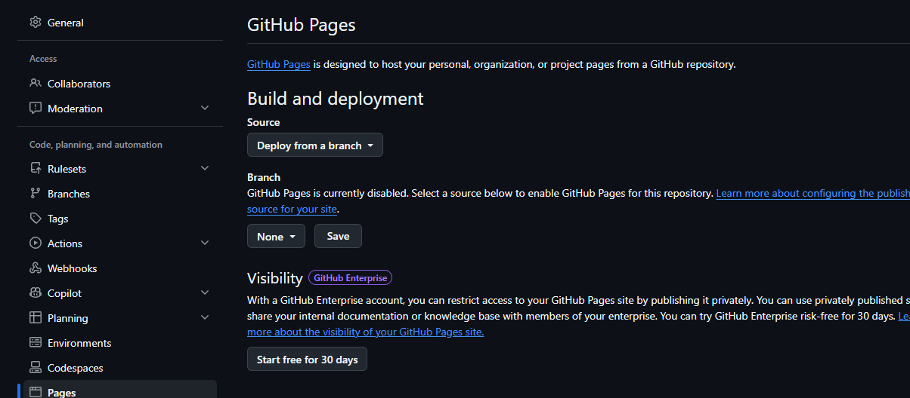
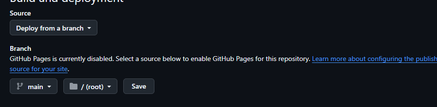
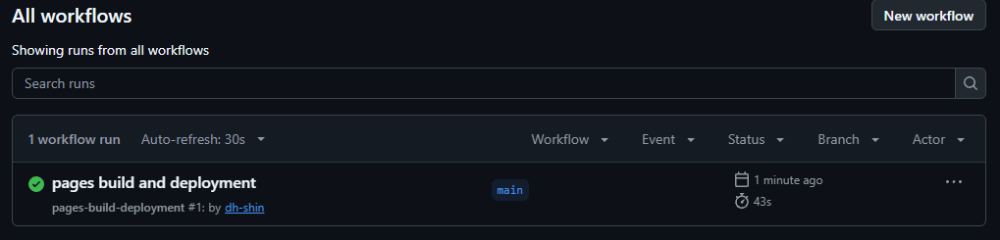
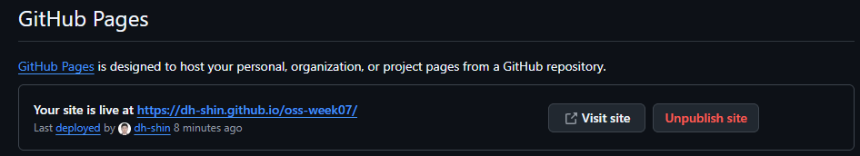

# P4. GitHub Pages 로 공개하기 — `p4: published`

지금 레시피 페이지는 내 컴퓨터에서만 보입니다(주소가 `file:///…`). **GitHub Pages** 를 켜면 GitHub 이 저장소의 HTML·CSS·그림 파일을 그대로 웹 서버에 올려 주고, 누구나 열 수 있는 주소를 붙여 줍니다. 서버를 따로 빌리거나 돈을 낼 필요가 없습니다(Public 저장소는 무료).

이 문제에서 하는 것:
- Pages 켜기 (브라우저, 저장소 Settings)
- 배포가 끝나기를 기다렸다가 주소로 열어 보기
- 페이지를 한 번 고쳐서, push 하면 Pages 에도 반영되는 것 보기

끝나면 내 페이지 주소는 이렇게 됩니다.
```
https://<내 ID>.github.io/oss-week07/
```

## Pages 켜기 (브라우저)

1. GitHub 의 내 저장소 `oss-week07` 첫 화면에서 최근 커밋이 `p3: box model` 인지 봅니다. Pages 는 GitHub 에 올라간 파일을 공개하므로, push 하지 않은 내용은 나오지 않습니다.
2. 저장소 위쪽 탭 **Settings** → 왼쪽 메뉴 **Code, planning, and automation** 아래 **Pages**.

   
3. **Build and deployment** 의 **Source** 가 **Deploy from a branch** 인지 확인합니다. 아니면 그것으로 바꿉니다.
4. 바로 아래 **Branch** 에서 `None` 을 눌러 **main** 으로 바꿉니다. 옆 칸의 폴더는 **/ (root)** 그대로 둡니다. "main 브랜치의 맨 위 폴더에 있는 파일을 공개한다" 는 뜻입니다. `index.html` 이 거기에 있기 때문에 이렇게 고릅니다.
5. **Save**.

   

## 배포 기다리기 (브라우저)

6. 저장소 위쪽 탭 **Actions** 를 엽니다. `pages build and deployment` 라는 작업이 주황색 돌아가는 동그라미(`In progress`)로 보입니다. 1분 안팎 뒤 F5 를 눌러 초록 체크 ✓ 로 바뀌어 있으면 배포가 끝난 것입니다. 이 작업은 내가 만든 것이 아니라 5번의 Save 를 누르면 GitHub 이 저절로 돌립니다.

   
7. 다시 **Settings → Pages** 로 가서 F5. 위쪽에 `Your site is live at https://<내 ID>.github.io/oss-week07/` 가 보입니다. **Visit site** 를 누릅니다.

   

## 열어 보기 (브라우저)

8. **확인**: 로컬에서 보던 것과 똑같은 레시피 페이지가 보이면 됩니다. 주소창이 `https://<내 ID>.github.io/oss-week07/` 입니다. 배경색과 하얀 상자(CSS), 그림이 다 나오는지 봅니다.
   - 하얀 화면에 기본 글꼴만 나오면 CSS 를 못 읽은 것, 그림 자리에 깨진 아이콘이 나오면 그림을 못 읽은 것입니다. 둘 다 대부분 **대소문자** 문제입니다. 부록의 "로컬에선 되는데 Pages 에서만" 을 봅니다.
   - 주소 끝의 `index.html` 은 쓰지 않아도 됩니다. 웹 서버는 폴더 주소로 들어오면 그 폴더의 `index.html` 을 먼저 보여 줍니다.
9. 휴대폰으로도 같은 주소를 열어 봅니다. 내 노트북이 꺼져 있어도 열립니다. 파일이 GitHub 에 있기 때문입니다.
10. 저장소 첫 화면 오른쪽 **About** 옆 톱니바퀴 → **Use your GitHub Pages website** 를 체크 → **Save changes**. About 에 Pages 주소 링크가 생겨, 저장소를 보는 사람이 바로 페이지로 갈 수 있습니다.

## 고쳐서 다시 반영하기 (VS Code → 터미널 → 브라우저)

11. `index.html` 의 맨 아래 링크 줄 다음(`</div>` 위)에 한 줄을 더합니다.
    ```html
    <p>이 페이지는 GitHub Pages 로 공개했습니다.</p>
    ```
12. 저장하고 커밋, push 합니다.
    ```
    git add index.html
    git commit -m "p4: published"
    git push
    ```
13. **Actions** 탭에 `pages build and deployment` 가 하나 더 생겨 돌아갑니다. push 할 때마다 GitHub 이 다시 배포하는 것입니다. 초록 체크가 되면 Pages 주소의 탭에서 F5. 11번의 문장이 보이면 됩니다. 안 보이면 `Ctrl+F5`(캐시 무시 새로 고침).

---

[← 문제 목록](../README.md#문제) · [이전: P3](P3_box.md) · [다음: P5](P5_specificity.md) · [부록: 흔한 오류](../README.md#부록-흔한-오류)
