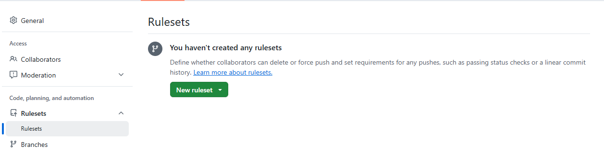
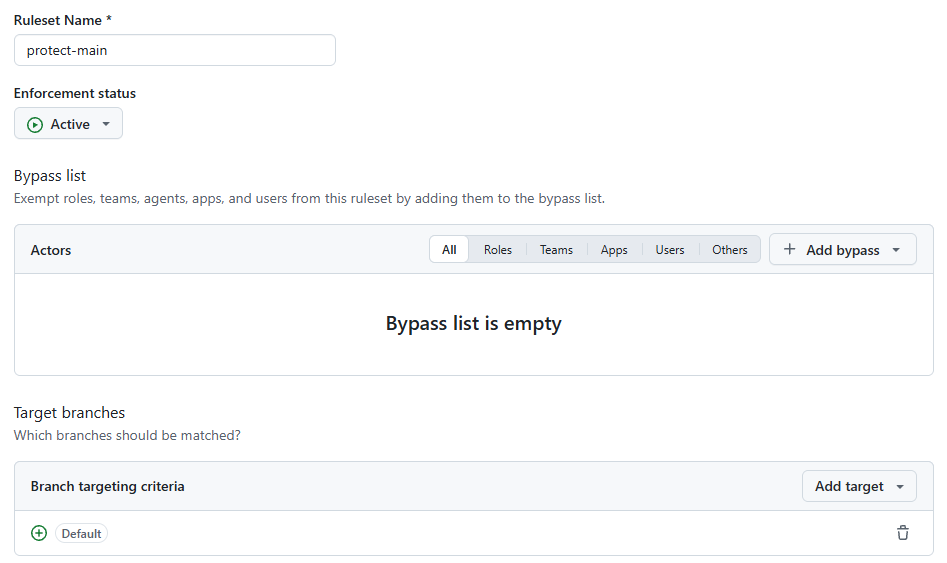
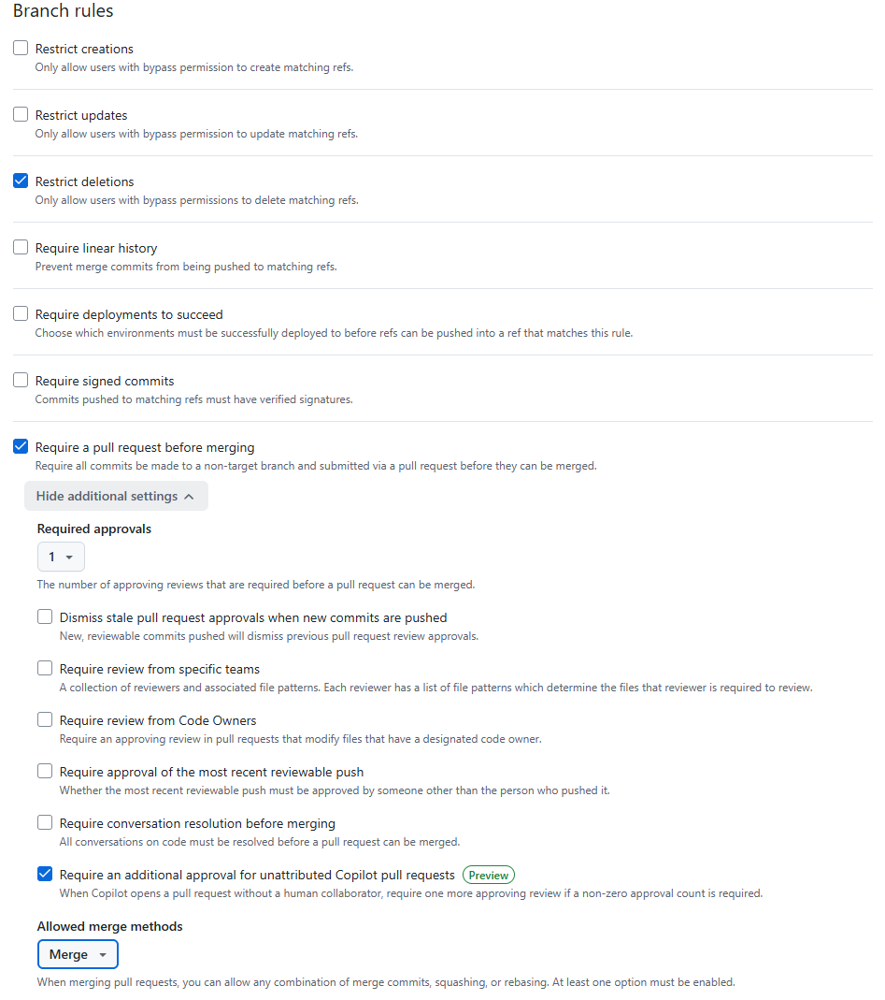
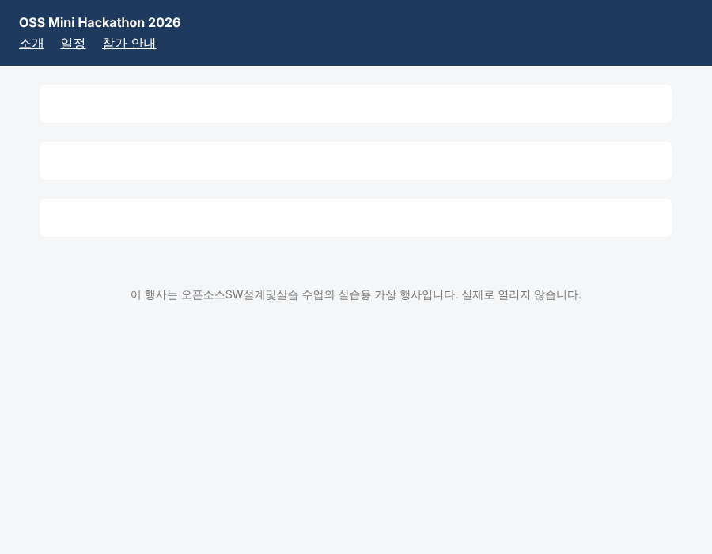

# T0. 팀 저장소 만들고 보호하기 — A (B·C 는 수락)

팀 페이지는 팀 프로젝트 저장소와 **다른 저장소**에 만듭니다. A 가 템플릿으로 새 저장소를 만들고, B·C 를 초대하고, main 에 규칙(ruleset)을 겁니다. 규칙을 걸면 main 에는 PR 로만, 팀원 한 명의 승인을 받아야 들어갑니다.

이 문제에서 하는 것:
- A: 템플릿으로 저장소 만들기 → B·C 초대 → ruleset (브라우저)
- B·C: 초대 수락 (브라우저)
- A·B·C: 각자 clone 하고 페이지 열어 보기 (터미널, 브라우저)

## A: 저장소 만들기 (브라우저)

1. 템플릿 저장소 `https://github.com/kw-hdi-lab/oss2026-week07-team` 을 엽니다. 오른쪽 위 **Use this template** → **Create a new repository**.
2. **Owner** 는 A 의 계정, **Repository name** 은 `oss2026-week07-teamNN`(두 자리 조 번호), **Public** → **Create repository**.
3. 저장소에 `index.html`, `style.css`, `README.md` 가 보이면 됩니다.

## A: B·C 초대 (브라우저)

4. **Settings** → 왼쪽 메뉴 **Collaborators** → **Add people** → B 의 GitHub 아이디 → **Add <B의 ID>**. 같은 방법으로 C 도 초대합니다. C 가 오늘 오지 않았어도 지금 초대합니다.
5. 목록에 B·C 가 **Pending Invite** 로 보이면 됩니다.

## B·C: 초대 수락 (브라우저)

6. 주소창에 아래를 열고 **Accept invitation**.
   ```
   https://github.com/<A의 ID>/oss2026-week07-teamNN/invitations
   ```

## A: main 보호하기 (브라우저)

7. **Settings** → 왼쪽 메뉴 **Code, planning, and automation** 아래 **Rulesets** → **New ruleset** → **New branch ruleset**.

   
8. 위쪽 칸을 채웁니다.
   - **Ruleset Name**: `protect-main`
   - **Enforcement status**: **Active** (기본값 Disabled 로 두면 아무것도 막지 않습니다)
   - **Bypass list**: 비워 둡니다. A 도 넣지 않습니다.
   - **Target branches**: **Add target** → **Include default branch**

   
9. 아래 **Rules** 에서 **Require a pull request before merging** 을 체크하고, 펼쳐지는 설정에서
   - **Required approvals**: `1`
   - **Allowed merge methods**: **Merge** 만 남기고 Squash, Rebase 는 뺍니다.

   나머지는 건드리지 않습니다.

   
10. 맨 아래 **Create**. Rulesets 목록에 `protect-main` 이 **Active** 로 보이면 됩니다.

## A·B·C: clone 하고 열어 보기 (터미널, 브라우저)

11. 각자 실습 폴더에서 clone 합니다. B·C 도 **A 의 저장소 주소**를 씁니다.
    ```
    git clone https://github.com/<A의 ID>/oss2026-week07-teamNN.git
    cd oss2026-week07-teamNN
    code .
    ```
12. 파일 탐색기에서 이 폴더의 `index.html` 을 더블클릭해 브라우저로 엽니다. **확인**: 남색 머리글(행사 이름과 메뉴 세 개), 비어 있는 하얀 칸 세 개, 맨 아래 회색 글씨의 "실습용 가상 행사" 문장이 보이면 됩니다.

    

    하얀 칸 세 개가 위에서부터 A 의 `#intro`, B 의 `#schedule`, C 의 `#faq` 자리입니다.

---

[← 문제 목록](../README.md#문제) · [이전: P5](P5_specificity.md) · [다음: T1](T1_my_section.md) · [부록: 흔한 오류](../README.md#부록-흔한-오류)
