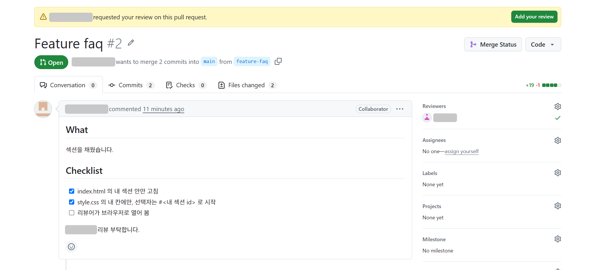
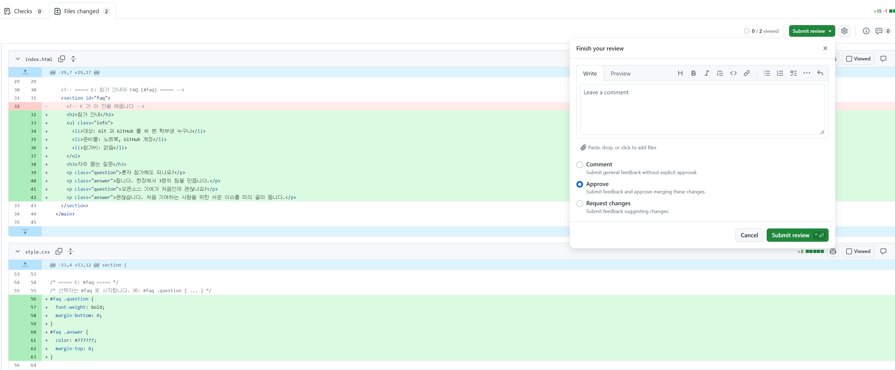
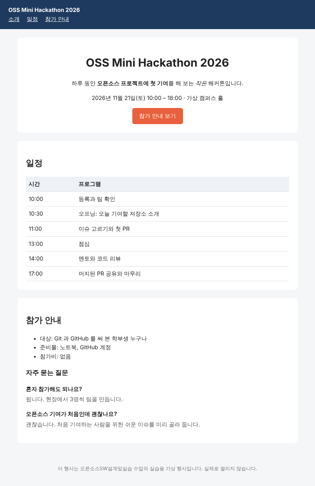

# T2. 브라우저로 열어 보고 리뷰하기 — 리뷰어

HTML·CSS 는 코드만 읽어서는 화면이 어떻게 나올지 알기 어렵습니다. 리뷰어는 PR 의 브랜치를 내 노트북으로 받아 **브라우저로 직접 열어 본 뒤** 승인합니다.

| PR | 리뷰어 |
|---|---|
| A 의 `intro` | B |
| B 의 `schedule` | A |
| C 의 `faq` | A 또는 B |

## 리뷰할 PR 찾기 (브라우저)

1. 팀원이 나를 리뷰어로 지정하면 GitHub 알림(오른쪽 위 종 모양)과 메일이 옵니다. 알림을 누르거나, 팀 저장소의 **Pull requests** 탭에서 그 PR 을 엽니다. PR 위쪽에 노란 띠 **requested your review on this pull request** 와 초록색 **Add your review** 버튼이 보이면, 내가 리뷰할 PR 이 맞습니다. 띠 아래 `wants to merge … from <브랜치>` 의 `<브랜치>` 가 4번에서 옮겨 갈 브랜치 이름입니다.

   

## PR 브랜치 받아서 열어 보기 (터미널 → 브라우저)

2. 내 브랜치 작업을 커밋·push 해 둔 상태인지 `git status` 로 봅니다. `nothing to commit, working tree clean` 이면 됩니다.
3. GitHub 에 올라온 팀원의 브랜치를 받아 옵니다.
   ```
   git fetch
   ```
   출력에 `* [new branch]      schedule   -> origin/schedule` 처럼 팀원의 브랜치가 보입니다.
4. 그 브랜치로 옮깁니다. `<브랜치>` 는 리뷰할 PR 의 브랜치 이름(`intro`, `schedule`, `faq`)입니다.
   ```
   git checkout <브랜치>
   ```
   `branch '<브랜치>' set up to track 'origin/<브랜치>'` 와 `Switched to a new branch '<브랜치>'` 가 나오면 됩니다. 이제 내 폴더의 파일이 팀원이 올린 상태로 바뀌었습니다.
5. 브라우저의 팀 페이지 탭에서 F5. 팀원의 섹션이 채워진 화면이 보입니다. (같은 `index.html` 파일인데 브랜치를 옮겼기 때문에 내용이 바뀐 것입니다.)

## 살펴볼 것 (브라우저, GitHub)

6. 아래 네 가지를 봅니다.
   1. 그 섹션이 [T1](T1_my_section.md) 의 **해야 할 것** 대로 보이는가
   2. **다른 칸, 머리글, 바닥글의 모양이 그대로인가** (main 일 때와 비교)
   3. PR 의 **Files changed** 에서 `style.css` 의 새 선택자가 **전부 그 섹션 id 로 시작**하는가
   4. 바뀐 파일이 `index.html`, `style.css` 둘뿐이고, 내 섹션·내 칸 밖에 빨간 줄(지운 줄)이 없는가
7. **Files changed** 에서 한 줄을 골라 줄 댓글을 남깁니다(**Start a review**). 좋은 점이든 질문이든 됩니다. 예: `inline-block 덕분에 버튼 위아래 여백이 잘 잡혔네요`, `#schedule th, #schedule td 로 묶은 거 좋습니다`.
8. 6번에 걸리는 것이 **있으면** **Submit review** → **Request changes** 로 무엇을 고칠지 적습니다. 작성자가 고쳐 push 하면 `git checkout <브랜치>` → `git pull` 로 고친 내용을 받고 5 ~ 8번을 다시 합니다. 걸리는 것이 **없으면** **Submit review** → **Approve** → **Submit review**.

   

## 내 브랜치로 돌아가기 (터미널)

9. 리뷰한 브랜치에서는 아무것도 고치지 않습니다. 내 작업 브랜치나 main 으로 돌아갑니다.
   ```
   git checkout main
   ```

## 작성자: 머지하고 정리 (브라우저 → 터미널)

10. 내 PR 이 승인되면 **Merge pull request** → **Confirm merge** → **Delete branch**.
11. ```
    git checkout main
    git pull
    git branch -d <내 브랜치>
    ```
12. **확인**: 세 PR 이 모두 머지된 뒤 `git pull` 하고 브라우저에서 F5. 세 섹션이 모두 채워진 페이지가 보이면 됩니다.

    

---

[← 문제 목록](../README.md#문제) · [이전: T1](T1_my_section.md) · [다음: T3](T3_pages.md) · [부록: 흔한 오류](../README.md#부록-흔한-오류)
